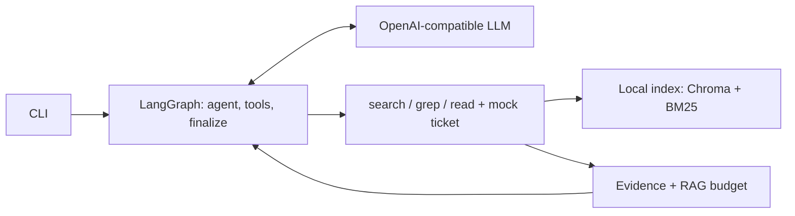

# wiki-graph

[wiki-agent](https://github.com/liushupeng/wiki-agent) 的 **Python / LangGraph 对照实现**：用 **LangChain + LangGraph** 栈复刻「检索 → 证据感知 Agent → 有来源回答 / 明确拒答」的产品叙事，**不是** wiki-agent 的 fork 或替代品。

```text
fixtures corpus
  -> hybrid index (Chroma + BM25)
  -> LangGraph agent + RAG tools
  -> evidence status + RAG budget
  -> cited answer / explicit abstention
```

## 与 wiki-agent

| | [wiki-agent](https://github.com/liushupeng/wiki-agent) | wiki-graph（本仓） |
|---|------------------------|-------------------|
| 定位 | TypeScript 主实现：完整混合检索、治理、可观测、离线评测 | Python 对照：LangGraph 编排 + 简化 RAG + 证据预算 |
| 索引 | BM25 + BGE-M3 + LanceDB，离线索引管线 | 本地 sentence-transformers + Chroma + BM25 |
| 运行时 | Native / Pi 双 Harness | LangGraph `agent` ↔ `tools` + `finalize` |
| 配置习惯 | `BASE_URL` / `API_KEY` / `MODEL_NAME` | 同名 LLM 变量 + `WIKI_GRAPH_*` / `RAG_BUDGET` |

生产级细节、评测数字与架构说明以母项目为准；本仓侧重 **可克隆、可索引、可 ask、可与母项目同题对照**。

## 源码布局

与 [wiki-agent `src/`](https://github.com/liushupeng/wiki-agent/tree/master/src) 类似：`src/` 按功能分目录（`graph`、`tools`、`rag`、`policy`、`eval`），离线测试在 `src/tests/` 下与模块一一对应；CLI 实现在 `src/cli.py`。

## 架构



## 核心能力

- **混合 RAG（简化版）**：Markdown 语料分块；向量检索与 BM25 RRF 融合；`index` / `search` / `read` 可脱离 LLM 调试。
- **证据与预算**：RAG 工具结果记入库存，`evidence_status` 为 `insufficient | partial | sufficient`；`RAG_BUDGET` 耗尽后不再向模型暴露 RAG 工具；无证据时拒答模板收口。
- **工具**：`search_notes`、`grep_notes`、`read_note` 与 wiki-agent 对齐；`query_incident_ticket` 为 Mock 工单（非 RAG，展示 Tool Calling 广度）。
- **评测**：`fixtures/e2e/questions.json` 为母项目 12 题子集；`wiki-graph eval` 跑简化 TaskContract（需 LLM）。
- **Checkpoint**：内存 checkpointer + `repl` 多轮会话。

## 快速开始

**要求**

- Python 3.11+
- OpenAI 兼容 Chat API（仅 `ask` / `check-llm` / `eval`；**`index` 与 `search` 默认不走 Chat API**）
- 离线索引：**本地** embedding（默认 `models/bge-small-zh-v1.5/`，需**自行离线下载**权重，程序不联网拉模型）

**安装**

```bash
git clone https://github.com/liushupeng/wiki-graph.git
cd wiki-graph
uv sync
# 或: pip install -e ".[dev]"
```

**配置**

复制 [.env.example](.env.example) 为 `.env`（Linux/macOS：`cp .env.example .env`）。

至少在 `.env` 中配置：

```env
BASE_URL=https://api.deepseek.com
API_KEY=your_api_key
MODEL_NAME=your_model
```

**Embedding 模型（离线下载）**

将 [BAAI/bge-small-zh-v1.5](https://huggingface.co/BAAI/bge-small-zh-v1.5) 整仓放到 `models/bge-small-zh-v1.5/`（需含 `config.json` 与权重文件）。镜像：<https://hf-mirror.com/BAAI/bge-small-zh-v1.5>。未放好就 `index` 时 CLI 会打印相同说明。

**索引与问答**

```bash
wiki-graph index
wiki-graph check-llm
wiki-graph ask "HTTP 缓存里 max-age=300 表示什么？"
```

### 常用 CLI

| 命令 | 说明 |
|------|------|
| `index` | 从语料目录构建本地索引（默认 `var/indexes/wiki-graph-v1/raw-wiki`） |
| `search <query>` | 仅检索，不调用 LLM |
| `read <path>` | 按相对路径读笔记片段 |
| `check-llm` | 探测 Chat API |
| `ask <question>` | LangGraph Agent 单次问答 |
| `ask <question> --stream` | 流式打印回答增量 |
| `repl` | 多轮 REPL（共享 checkpoint） |
| `eval` | E2E 子集（简化 contract，需 API） |

安装 `pip install -e ".[dev]"` 后使用 `wiki-graph`，或 `python -m cli`（需在仓库根目录且 `PYTHONPATH` 含 `src`，一般仅开发调试）。

## 开发与验证

```bash
# 离线索引（默认 local，无需 API_KEY）
wiki-graph index
# 单元测试用假向量，加快 CI
export WIKI_GRAPH_EMBEDDING=fake   # Windows: $env:WIKI_GRAPH_EMBEDDING="fake"
pytest -q

# 有 API 时跑 E2E 子集（LLM 波动可能导致偶发失败）
wiki-graph eval
```

## 环境变量

| 变量 | 含义 |
|------|------|
| `BASE_URL` | OpenAI 兼容 API base |
| `API_KEY` | API key |
| `MODEL_NAME` | 模型 id |
| `WIKI_GRAPH_CORPUS_DIR` | 语料目录，默认 `fixtures/corpus` |
| `WIKI_GRAPH_INDEX_ROOT` | 索引根目录，默认 `var/indexes`（同 wiki-agent `indexDirectory`） |
| `WIKI_GRAPH_INDEX_PROFILE` | 索引 profile，默认 `wiki-graph-v1` |
| `WIKI_GRAPH_INDEX_VARIANT` | 索引 variant，默认 `raw-wiki`；未设置时可读 `RAG_INDEX_VARIANT` |
| `WIKI_GRAPH_INDEX_DIR` | 覆盖整条索引输出路径（忽略 root/profile/variant） |
| `RAG_BUDGET` | 单次对话内 RAG 工具调用上限，默认 `4` |
| `WIKI_GRAPH_EMBEDDING` | `local`（默认）/ `fake`（pytest）/ `openai`（可选付费 API） |
| `EMBEDDING_MODEL_NAME` | 本地默认 `BAAI/bge-small-zh-v1.5`；`openai` 时默认 `text-embedding-3-small` |
| `WIKI_GRAPH_EMBEDDING_DEVICE` | 本地推理设备，默认 `cpu` |
| `WIKI_GRAPH_EMBEDDING_MODEL_PATH` | 本地模型目录，默认 `models/bge-small-zh-v1.5` |
| `EMBEDDING_BASE_URL` / `EMBEDDING_API_KEY` | 仅 `WIKI_GRAPH_EMBEDDING=openai` 时需要 |

完整说明见 [.env.example](.env.example)。

## 语料

`fixtures/corpus/` 与 `fixtures/e2e/questions.json` 来自 wiki-agent 公开快照（语料与 e2e 题 `id` 保留，便于交叉验证）。

**索引目录（与 wiki-agent 对照）**：母项目离线索引落在 `var/indexes/{profile}/{variant}/`（见 `config/rag.indexes.jsonc`）。本仓简化为单一 profile `wiki-graph-v1`，默认 variant `raw-wiki`，产物为 `manifest.json`、`chunks.jsonl` 与 `chroma/`（非 LanceDB / `index.json`）。目录在 `var/` 下，本地生成、不入库；若你曾使用已废弃的 `.wiki_graph_index/`，请重新 `wiki-graph index` 或设 `WIKI_GRAPH_INDEX_DIR` 指向旧目录。

## 项目边界

- 本地 CLI，无 Web UI、无多租户部署面
- 不复制 wiki-agent 的 BGE / LanceDB 离线索引与完整 TaskContract / Trace 管线
- 私有语料、API 密钥与索引目录不进入 Git
- LLM 与 Embedding 行为受供应商与模型版本影响

## License

[MIT](LICENSE)