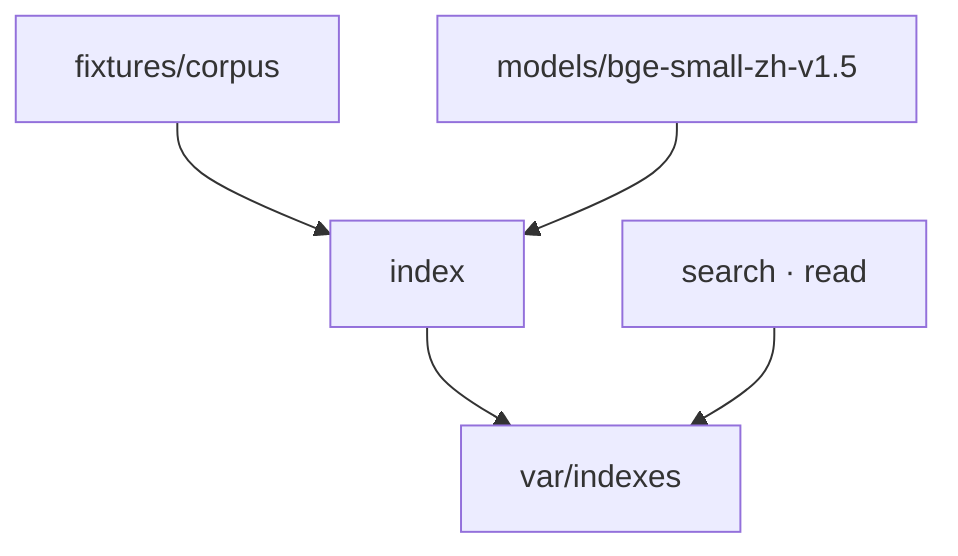
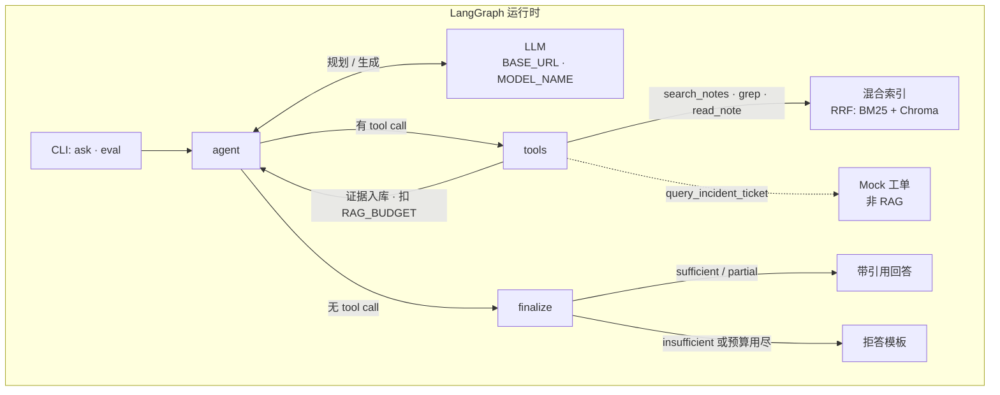

# wiki-graph

[wiki-agent](https://github.com/liushupeng/wiki-agent) 的 **Python / LangGraph 对照实现**：复刻「检索 → 证据感知 Agent → 有来源回答 / 明确拒答」流程；**不是**其 fork 或替代品。与 wiki-agent 共享 `fixtures` 语料与 e2e 题 `id`，便于同题对照；生产级细节以母项目为准。

```text
fixtures/corpus -> 本地 embedding -> var/indexes (BM25 + Chroma)
  -> LangGraph: agent <-> tools -> finalize
  -> evidence + RAG_BUDGET -> 引用回答 / 拒答
```

## 源码布局

`src/` 按功能分目录（`graph`、`tools`、`rag`、`policy`、`eval`），测试在 `src/tests/`；CLI 在 `src/cli.py`。

## 架构

### 索引与检索

默认目录 `var/indexes/wiki-graph-v1/raw-wiki/`（`chunks.jsonl` + `chroma/`）。



### Agent 运行时



## 核心能力

- **混合 RAG（简化版）**：Markdown 语料分块；向量检索与 BM25 RRF 融合；`index` / `search` / `read` 可脱离 LLM 调试。
- **证据与预算**：RAG 工具结果记入库存，`evidence_status` 为 `insufficient | partial | sufficient`；`RAG_BUDGET` 耗尽后不再向模型暴露 RAG 工具；无证据时拒答模板收口。
- **工具**：`search_notes`、`grep_notes`、`read_note`；`query_incident_ticket` 为 Mock 工单（非 RAG）。
- **评测**：`fixtures/e2e/questions.json`（12 题）；`wiki-graph eval` 跑简化 TaskContract（需 LLM）。
- **Checkpoint**：内存 checkpointer；`wiki-graph ask` 无参数时多轮交互。

## 快速开始

**要求**

- Python 3.11+
- OpenAI 兼容 Chat API（`ask` / `check-llm` / `eval`）
- 索引用本地 embedding，默认目录 `models/bge-small-zh-v1.5/`

**安装**

```bash
git clone https://github.com/liushupeng/wiki-graph.git
cd wiki-graph
uv sync
# 或: pip install -e ".[dev]"
```

**配置**

复制 [.env.example](.env.example) 为 `.env`（Linux/macOS：`cp .env.example .env`）。

至少在 `.env` 中配置：

```env
BASE_URL=https://api.deepseek.com
API_KEY=your_api_key
MODEL_NAME=your_model
```

**索引与问答**

```bash
wiki-graph index
wiki-graph check-llm
wiki-graph ask "HTTP 缓存里 max-age=300 表示什么？"
```

### 常用 CLI

| 命令 | 说明 |
|------|------|
| `index` | 从语料目录构建本地索引（默认 `var/indexes/wiki-graph-v1/raw-wiki`） |
| `search <query>` | 混合检索 |
| `read <path>` | 按相对路径读笔记片段 |
| `check-llm` | 探测 LLM 配置 |
| `ask <question>` | 单轮问答（默认流式输出） |
| `ask` | 多轮交互（空行退出，共享 thread） |
| `ask <question> --no-stream` | 单轮结束后一次性打印全文 |
| `eval` | E2E 子集（简化 contract，需 API） |

安装 `pip install -e ".[dev]"` 后使用 `wiki-graph`，或 `python -m cli`（需在仓库根目录且 `PYTHONPATH` 含 `src`，一般仅开发调试）。

## 开发与验证

```bash
wiki-graph index
pytest -q
# 需要测真实本地向量时：WIKI_GRAPH_EMBEDDING=local pytest -q

# 有 API 时跑 E2E 子集（LLM 波动可能导致偶发失败）
wiki-graph eval
```

## 环境变量

| 变量 | 含义 |
|------|------|
| `BASE_URL` | OpenAI 兼容 API base |
| `API_KEY` | API key |
| `MODEL_NAME` | 模型 id |
| `WIKI_GRAPH_CORPUS_DIR` | 语料目录，默认 `fixtures/corpus` |
| `WIKI_GRAPH_INDEX_ROOT` | 索引根目录，默认 `var/indexes` |
| `WIKI_GRAPH_INDEX_PROFILE` | 索引 profile，默认 `wiki-graph-v1` |
| `WIKI_GRAPH_INDEX_VARIANT` | 索引 variant，默认 `raw-wiki`；未设置时可读 `RAG_INDEX_VARIANT` |
| `WIKI_GRAPH_INDEX_DIR` | 覆盖整条索引输出路径（忽略 root/profile/variant） |
| `RAG_BUDGET` | 单次对话内 RAG 工具调用上限，默认 `4` |
| `WIKI_GRAPH_EMBEDDING` | CLI 默认 `local`；`pytest` 未设置时自动 `fake` / `openai` |
| `EMBEDDING_MODEL_NAME` | 本地默认 `BAAI/bge-small-zh-v1.5`；`openai` 时默认 `text-embedding-3-small` |
| `WIKI_GRAPH_EMBEDDING_DEVICE` | 本地推理设备，默认 `cpu` |
| `WIKI_GRAPH_EMBEDDING_MODEL_PATH` | 本地模型目录，默认 `models/bge-small-zh-v1.5` |
| `EMBEDDING_BASE_URL` / `EMBEDDING_API_KEY` | `WIKI_GRAPH_EMBEDDING=openai` 时 |

完整说明见 [.env.example](.env.example)。

## 语料

- `fixtures/corpus/`：内置 Markdown 语料  
- 索引产物：`var/indexes/wiki-graph-v1/raw-wiki/`（`manifest.json`、`chunks.jsonl`、`chroma/`，不入库）

## 项目边界

- 本地 CLI，无 Web UI、多租户
- 简化版混合 RAG 与评测，不含完整 Trace / LanceDB 级索引管线
- 语料、API 密钥与索引目录不进入 Git

## License

[MIT](LICENSE)